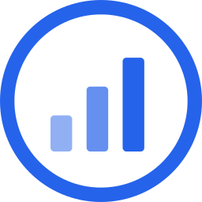

<p align="center">
  
</p>

# Quant Agent

**Personal trading & research assistant** by [RealCryptoCap](https://realcryptocap.com).

Quant Agent is an agentic harness for crypto traders. You give it a goal, it
runs the tools, and it returns research you can act on: market briefs, signal
reads, risk notes, backtests and trading bot drafts for HTX and Hyperliquid.
It is not a chat window. It can also trade for you through your own connected brokerage or exchange, with your approval on each order or for the whole job.

Built for the [emma Hackathon](https://hackathon.emma.ms/) (Builders track).

## What it does

- **Jobs.** Goal in, structured research out. Each job keeps its trace, sources and tool calls.
- **Schedules.** Re-run a research job on a timer and get the result in History.
- **Skills and MCP.** RealCryptoCap market data, TraderSpy, trading skills and a
  read-only decision receipt, wired as tools the agent can call.
- **GPU jobs through emma.** Heavy work (bot training, backtests, private model
  inference) is sent to the cheapest suitable GPU across clouds, picked live by
  the emma API, then torn down when the job ends.
- **Credits, not runs.** Usage is metered in inference credits shared with the
  RealCryptoCap Pro and Ultra plans.

## Status

Work in progress for the emma Hackathon (deadline 1 Dec 2026). The worker
surface runs today. Credit ledger, the RealCryptoCap MCP wiring and the emma
GPU lane are being built in this repo.

## Running it

```bash
bun install
bun run dev      # http://localhost:3000
bun run build    # production bundle in dist/
bun run test:run
```

Point it at your own OpenAI-compatible inference endpoint:

```bash
VITE_AGENTASIA_GATEWAY_URL=https://your-gateway bun run dev
```

## Attribution

Quant Agent is a derivative of the open-source `devs` application and is
distributed under its original MIT licence (see `LICENSE`). The Quant Agent
work, including branding, the trading skills, the market data tools and the
emma GPU lane, is ours. The upstream base remains theirs.

<p align="center">
  <a href="https://x.com/JasonParserSec">@JasonParserSec</a>
</p>
